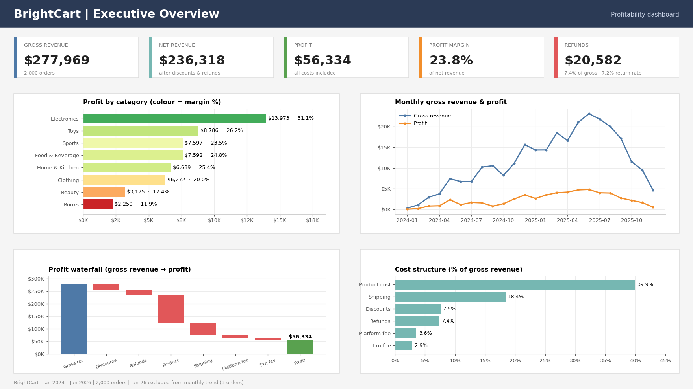
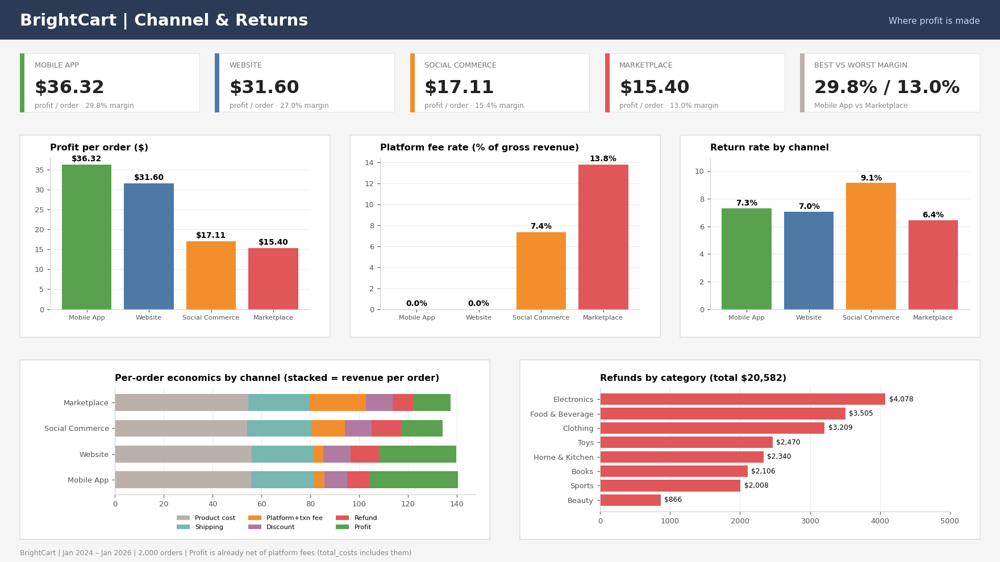
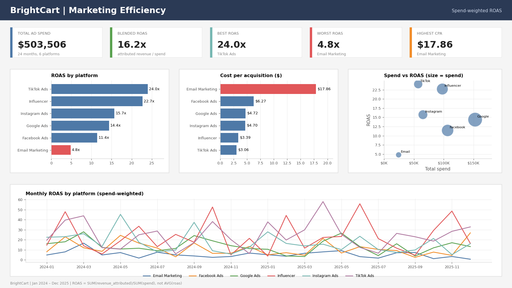

# BrightCart E-Commerce Profitability Analysis

Revenue kept growing at BrightCart, but margins kept shrinking. This project looks at 2,000 orders, 207 products and 24 months of ad spend to find out where the profit is being lost.

## Overview

| Metric | Value |
|---|---|
| Gross revenue | $277,969 |
| Net revenue | $236,318 |
| Profit | $56,334 |
| Profit margin | 23.8% |
| Refunds | $20,582 (7.4% of gross revenue) |

**Period:** Jan 2024 to Jan 2026
**Scope:** 4 sales channels, 8 product categories, 6 marketing platforms
**Tools:** SQL (PostgreSQL syntax)

## Key Findings

### Category
- Electronics is the top performer: $13,973 profit at a 31.1% margin.
- Books is the weakest at 11.9%, followed by Beauty at 17.4%.
- Sales are healthy in both, so the issue is cost or pricing, not demand.

### Channel

| Channel | Profit per order | Margin | Platform fee | Return rate |
|---|--:|--:|--:|--:|
| Mobile App | $36.32 | 29.8% | 0% | 7.3% |
| Website | $31.60 | 27.0% | 0% | 7.0% |
| Social Commerce | $17.11 | 15.4% | 7.4% | 9.1% |
| Marketplace | $15.40 | 13.0% | 13.8% | 6.4% |

- Mobile App and Website drive most of the profit.
- Marketplace has a similar order value to the other channels but keeps less than half the profit per order, because of its 13.8% fee.
- Social Commerce has the highest return rate (9.1%) on top of a 7.4% fee.

### Returns
- Refunds cost $20,582, about 7.4% of gross revenue.
- Electronics has the largest refund total ($4,078). Website has the largest by channel ($9,384), mostly due to order volume.

### Marketing

- Blended ROAS is 16.2x across $503,506 of spend.
- TikTok Ads (24.0x) and Influencer (22.7x) perform best, both under $3.50 CPA.
- Email Marketing is the weakest at 4.8x ROAS and $17.86 CPA.

## Recommendations

1. Renegotiate the Marketplace fee, or hold back spend on that channel until margins improve.
2. Review Books and Beauty at the unit-cost level (sourcing and shipping vs. selling price).
3. Shift budget from the weakest platform-months toward TikTok and Influencer instead of cutting every platform equally.
4. Report return rate every month alongside revenue and profit.

## Data Notes

- Data quality checks were run first: duplicate keys, cost and profit tie-outs, impossible values, refund consistency and platform fee logic.
- Profit already includes platform fees, so they are not subtracted a second time.
- ROAS is calculated as total attributed revenue divided by total spend, so small months don't skew the result.
- Order volume drops sharply from October 2025, so the final months are left out of the trend charts.

## Files

| File | Description |
|---|---|
| `dataqualityvalidation.sql` | Data quality checks |
| `Exploratory_Data_Analysis.sql` | Category, channel and marketing analysis |
| `financial_model.sql` | P&L, unit economics, scenarios and sensitivity |
| `images/` | Dashboard screenshots |
| `orders.csv`, `products.csv`, `marketing_spend.csv` | Source data |
